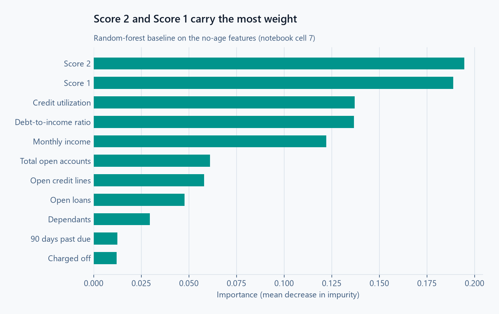
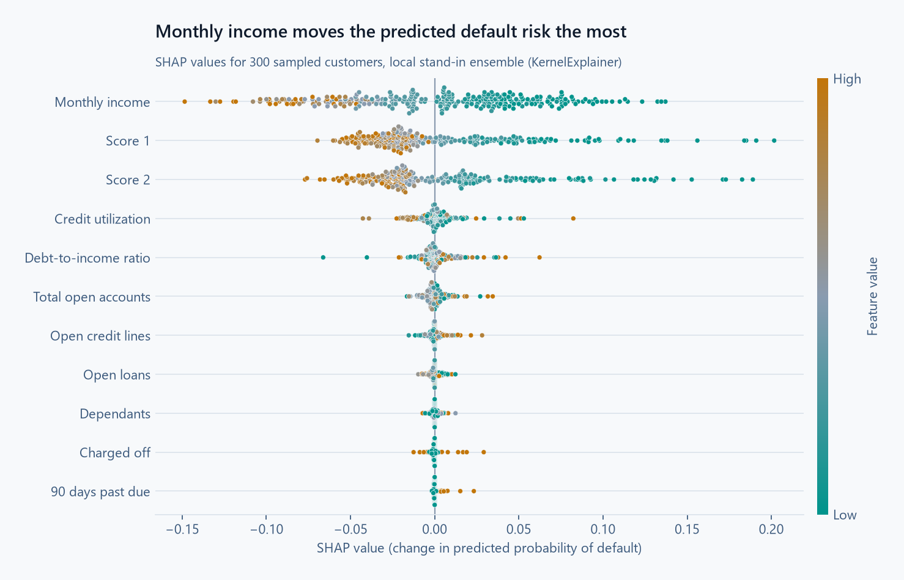
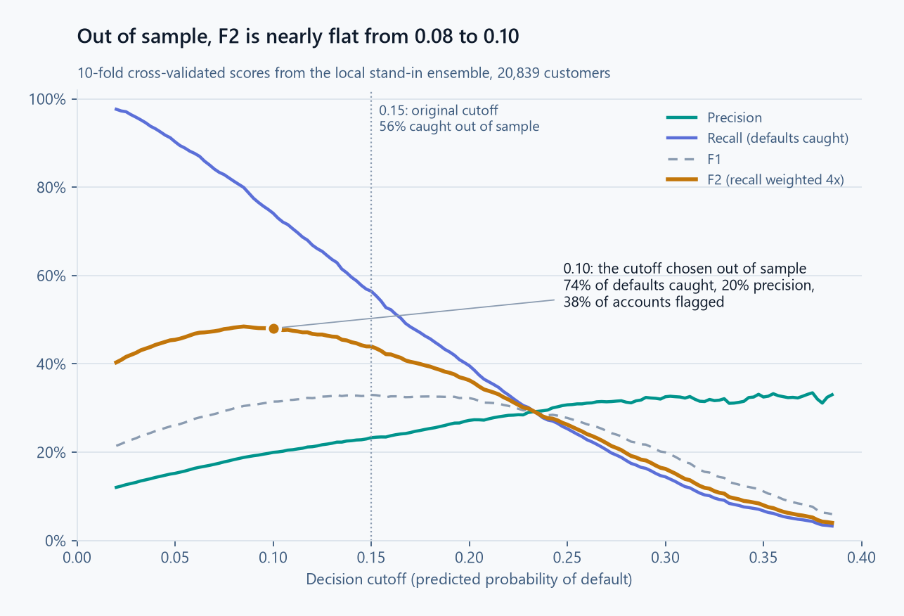

# Financial Risk Modeling: Loan Default Prediction

**Author:** Daniel W. Livingston, Senior Data Scientist

## Overview
This repository contains an end-to-end machine learning pipeline designed to predict financial loan defaults using **Azure Machine Learning SDK v2** and **Azure AutoML**. The project emphasizes not only predictive accuracy but also regulatory compliance and business-driven decision-making.

The champion model, a `VotingEnsemble`, was built to identify high-risk accounts prior to charge-off, allowing for early intervention strategies while adhering to fair lending laws.

The same model is also rebuilt on **Databricks** (Unity Catalog, MLflow, Optuna), with tuning kept away from the holdout and a champion/challenger registry: see [Databricks Version](#databricks-version).

## Repository Structure
*   `notebooks/Notebook.ipynb`: Feature engineering, Azure AutoML orchestration, scoring, threshold analysis, and SHAP.
*   `notebooks/validate_locally.py`: Out-of-sample validation of the model and cutoff (runs locally, no Azure needed).
*   `notebooks/make_charts.py`: Draws the charts in `images/` from the challenge's `train.csv`, in light and dark versions.
*   `presentations/Purpose_Data_Challenge.pdf`: The original executive summary as submitted. Its threshold metrics were measured on training data; see [Out-of-Sample Validation](#5-out-of-sample-validation) for corrected figures.
*   `images/`: Feature importances, SHAP values, and the out-of-sample precision/recall threshold curve.
*   `databricks/`: The Databricks version, as an Asset Bundle: three notebooks in `src/`, the job in `resources/`, and `src/loan_lib/`, the features, models, tuning and evaluation code that `validate_locally.py` also uses.
*   `tests/`: Unit tests for `loan_lib` on synthetic applicants (`python -m pytest -q tests`).

## Key Technical Highlights

### 1. Regulatory Compliance (ECOA) & Feature Engineering
To support compliance with the **Equal Credit Opportunity Act (ECOA)**, age and date of birth were removed from the champion model's features. Additional transformations included:
*   Consolidating active financial obligations (`total_open_accounts`).
*   Correcting a negative-dependents anomaly (`-1` recoded to `0`) and aligning column types to the registered model's schema.

A random-forest baseline on the no-age features ranks the two credit scores first, followed by credit utilization, debt-to-income and monthly income:

<picture>
  <source media="(prefers-color-scheme: dark)" srcset="images/Feature_Importance-dark.png">
  
</picture>

### 2. Azure AutoML Orchestration
The pipeline points AutoML directly at Azure Blob Storage via `MLTable`, avoiding local memory limits.
*   **Metric:** Optimized for `auc_weighted` with k-fold cross-validation on a ~90/10 target class imbalance (the notebook's no-age job is configured for 30 folds).
*   **Guardrails:** Compute costs capped with timeouts, trial limits, and concurrency limits (120 minutes and 50 trials for the no-age job; an earlier exploratory job used 5-fold CV, 60 minutes, and 15 trials).
*   **Champion Model:** A `VotingEnsemble` outperforming standalone XGBoost and LightGBM models, registered in MLflow as `Purpose_Challenger` (the no-age variant used for final scoring).

### 3. Business-Driven Threshold Optimization
The financial loss of a missed charge-off (false negative) outweighs the friction of a proactive account review (false positive), so the decision cutoff is chosen to maximize F2, which weighs recall four times as heavily as precision.

The original analysis set the cutoff at **0.15** using a precision/recall curve computed on the training data. Because the challenge's test set has no labels, that curve scored the same rows the model was trained on, which overstates performance. Section 5 re-measures it properly.

### 4. Global Interpretability
SHAP (via a `KernelExplainer` wrapper) was applied to the ensemble to identify the portfolio's main drivers of risk. Lower monthly income and lower credit scores were the dominant upward drivers of default risk; credit utilization and debt-to-income moved predictions far less.

The AutoML model stays in the Azure ML workspace, so the chart below repeats the notebook's SHAP setup (a 100-row background, 300 sampled customers) on the local stand-in ensemble from section 5. Its top five drivers come out in the same order as the notebook's run on the AutoML champion.

<picture>
  <source media="(prefers-color-scheme: dark)" srcset="images/SHAP-dark.png">
  
</picture>

### 5. Out-of-Sample Validation
`notebooks/validate_locally.py` rebuilds the no-age features and a comparable soft-voting ensemble (LightGBM + XGBoost + logistic regression), then measures performance on customers the model has not seen. Default rate: 10.2% of 20,839 customers.

| Evaluation | Cutoff | Defaults caught | Precision | AUC |
|------------|--------|-----------------|-----------|-----|
| Training data (original method) | 0.15 | 79.8% | 32.7% | 0.90 |
| 10-fold cross-validation | 0.15 | 56.5% | 23.3% | 0.76 |
| Held-out 20%, original cutoff | 0.15 | 58.0% | 23.1% | 0.76 |
| **Held-out 20%, cutoff chosen on the other 80%** | **0.10** | **74.6%** | **19.8%** | **0.76** |

<picture>
  <source media="(prefers-color-scheme: dark)" srcset="images/Precision_recall_curve-dark.png">
  
</picture>

**Takeaways:**
*   The original "75–80% of defaults caught" figure was a training-data result. At the same 0.15 cutoff, the model catches about 57% of defaults on unseen customers.
*   Choosing the F2 cutoff properly (on separate data) lands at **0.10**, which catches about **75% of defaults on a true holdout**, at the cost of lower precision: roughly 38% of accounts would be flagged for review. Whether that review volume is acceptable is a business decision about the cost of an account review versus a charge-off.
*   Out-of-sample AUC is about **0.76**, a solid but realistic level of separation for application-time credit data.

Library versions weren't pinned when this table was made. With the versions now in `requirements-dev.txt`, the same script picks a cutoff of 0.09 on the 80% and catches 80.0% of holdout defaults at 19.3% precision (AUC 0.762). F2 is nearly flat between 0.08 and 0.10, so small changes move the cutoff.

## Databricks Version

The same model, rebuilt on Databricks Free Edition (serverless) in [databricks/](databricks/) as an Asset Bundle with one job, `loan-default-pipeline`:

| Step | Notebook | What it does |
|------|----------|--------------|
| Load | `01_load_data.py` | Reads `train.csv` and `test.csv` from a Unity Catalog volume into the Delta tables `workspace.loans.raw_train` and `raw_test` |
| Tune and train | `02_tune_train.py` | Optuna search, one look at the holdout, and the model registered in Unity Catalog |
| Score | `03_score.py` | The champion model scores the 1,000 test customers into `workspace.loans.predictions` |

**What changed from the Azure version**
*   **Tuning:** Optuna searches LightGBM settings (trees, learning rate, leaves, minimum leaf size, row and column sampling, L2 penalty) by 5-fold cross-validated AUC, in place of AutoML's model search. Its default sampler (TPE) learns from earlier trials which settings score well, and trials that trail the median after a fold or two are stopped early. Every trial is a nested MLflow run.
*   **The holdout stays out of tuning:** the search and the F2 cutoff use only the 80% development split. The 20% holdout, the same customers as in section 5, is scored once at the end.
*   **Champion and challenger:** each run registers `workspace.loans.loan_default` as `@challenger`. It becomes `@champion` only if it beats the current champion's holdout AUC on the same customers, with a paired bootstrap interval above zero. Each run's holdout predictions are kept in `workspace.loans.holdout_predictions` for that comparison.
*   **No age by construction:** the registered model's input schema has no date of birth, so age can't reach it.
*   **One copy of the code:** the features, the stand-in ensemble and the cutoff search live in `databricks/src/loan_lib/`, which `validate_locally.py` now imports too.

**Holdout results (4,168 customers, run of 2026-10-22)**

| Model | AUC | PR-AUC | Cutoff | Defaults caught | Precision | Accounts flagged |
|-------|-----|--------|--------|-----------------|-----------|------------------|
| Stand-in for the AutoML ensemble (three models) | 0.762 | 0.252 | 0.09 | 80.0% | 19.3% | 42.4% |
| Optuna-tuned LightGBM (one model) | 0.771 | 0.251 | 0.09 | 79.3% | 19.3% | 41.9% |

Tuned minus stand-in, paired bootstrap: AUC **+0.010** (95% interval +0.003 to +0.016); PR-AUC −0.001 (−0.017 to +0.012).
*   **The test:** both models score the same customers, so the comparison resamples customers 2,000 times and scores both models on each resample. That keeps the pairing and separates the models' difference from the luck of which customers landed in the holdout.
*   **Plain meaning:** the single tuned model ranks customers slightly but reliably better, since the AUC interval stays above zero. On precision-recall, which weighs the rare defaults most, the two can't be told apart, and at the business cutoff they flag and catch nearly the same accounts. One tuned model does the job of the three-model ensemble.
*   **Assumptions:** customers are independent of one another, and the holdout resembles future applicants. The interval is the 2.5th to 97.5th percentile of the resampled differences.

The search settled on small trees (7 leaves, 250 trees, learning rate 0.016). The drivers match the Azure SHAP analysis: monthly income (41% of the mean absolute SHAP value) and the two credit scores (28% and 27%) carry almost everything, and utilization, debt-to-income and the account counts together add about 5%.

**Run it**

```
# Once: the schema, the volume and the challenge files (not in this repo)
databricks schemas create loans workspace --profile free
databricks volumes create workspace loans raw_files MANAGED --profile free
databricks fs cp train.csv dbfs:/Volumes/workspace/loans/raw_files/train.csv --profile free
databricks fs cp test.csv dbfs:/Volumes/workspace/loans/raw_files/test.csv --profile free

cd databricks
databricks bundle deploy --profile free
databricks bundle run loan_default_pipeline --profile free
```

Local checks: `python -m pip install -r requirements-dev.txt`, then `python -m pytest -q tests`.

## Technologies Used
*   **Cloud & MLOps:** Azure Machine Learning SDK v2, Azure AutoML, Databricks (Unity Catalog, Delta, Jobs, Asset Bundles), MLflow
*   **Core Data Stack:** Python, Pandas, NumPy, Scikit-Learn, LightGBM, XGBoost, Optuna
*   **Interpretability & Visualization:** SHAP, Matplotlib, Seaborn
